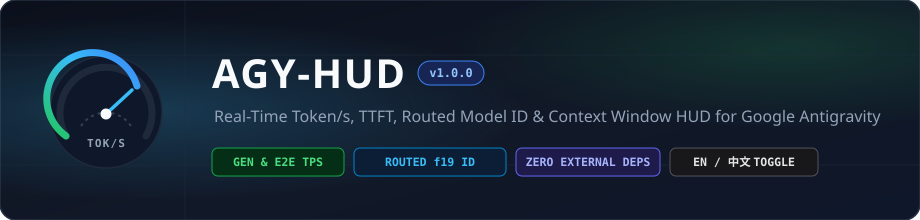
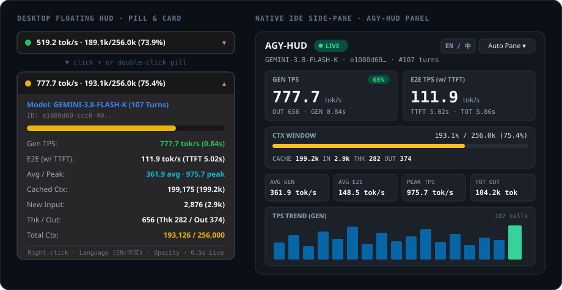

<div align="center">



<p>
  <strong>Google Antigravity 向けのリアルタイム生成速度・TTFT・モデル ID・コンテキスト使用量モニター</strong>
</p>

<p>
  <a href="LICENSE"></a>
  
  
  
  
  
</p>

<p>
  <a href="README.md">English</a> ·
  <a href="README.zh-CN.md">简体中文</a> ·
  <strong>日本語</strong> ·
  <a href="README.ko.md">한국어</a> ·
  <a href="README.es.md">Español</a> ·
  <a href="README.fr.md">Français</a> ·
  <a href="README.de.md">Deutsch</a> ·
  <a href="README.ru.md">Русский</a>
</p>

<p>
  <a href="#overview">概要</a> ·
  <a href="#quick-start">使い方</a> ·
  <a href="#protobuf-map">データ項目</a> ·
  <a href="CHANGELOG.md">変更履歴</a>
</p>

</div>

---

<div align="center">
  
</div>

---

## <a id="overview"></a>概要

**AGY-HUD** は、Google Antigravity 向けの軽量なデスクトップ常駐モニター、CLI ツール、およびサイドパネルプラグインです。ローカルの SQLite 会話データベースを読み取り専用モード（`?mode=ro`）で直接参照し、API プロキシや通信傍受を行わずに、生成速度、初回トークンまでの待ち時間（`TTFT`）、使用中のモデル ID、コンテキスト使用量を表示します。

### 主な特徴

- **ローカルデータの読み取り専用アクセス**：`~/.gemini/antigravity/conversations/<uuid>.db` を読み取り専用（`?mode=ro`）で開きます。API キーの登録やプロキシ設定は不要です。
- **生成速度と全体速度の計測**：初回トークン出力後のストリーミング速度（`GEN TPS = 出力トークン数 / ストリーム時間`）と、`TTFT` を含めたエンドツーエンド速度（`E2E TPS = 出力トークン数 / (TTFT + ストリーム時間)`）の両方を表示します。500 ミリ秒未満の短時間バッファ応答には `BUF` ラベルを付け、最大速度の統計が偏らないようにしています。
- **モデル名とコンテキスト上限の正確な取得**：記録内のモデル識別子 `f19`（例：`gemini-3.8-flash-k`）およびコンテキストウィンドウ上限 `f9.f10.f4`（例：`256,000`）をそのまま読み取ります。
- **外部パッケージ不要**：デスクトップウィンドウと CLI は Python 標準ライブラリ（`sqlite3`、`tkinter`）のみで動作し、サイドパネルプラグインは Node.js 組み込みの `node:sqlite` を利用します。`pip install` や `npm install` は不要です。
- **英語・中国語の UI 切り替え**：既定では短い英語略称（`GEN`、`E2E`、`STR`、`BUF`、`TTFT`、`THK`、`OUT`、`CTX`）で表示し、右クリックメニューやパネル上部のボタンからいつでも中国語表示へ切り替えられます。

---

## <a id="quick-start"></a>使い方

### 1. Antigravity 2.0 サイドパネルプラグイン

`~/.gemini/config/plugins/agy-hud` にインストールすると、ライト／ダークテーマに対応したサイドパネル上で TPS グラフと直近の履歴を確認できます：

```bash
python plugin/install_plugin.py
```

アンインストールする場合：

```bash
python plugin/install_plugin.py --uninstall
```

### 2. スタンドアロン・デスクトップウィンドウ & CLI

Antigravity の既存プラグイン設定を変更せず、単体で動作します：

- **Windows デスクトップ（コマンド画面なしで起動）**：`desktop/launch.bat` または `desktop/launch.pyw` をダブルクリック
- **Python GUI / CLI**：

```bash
# デスクトップ常駐ウィンドウを起動（既定：英語表示、500ms 間隔で更新）
python -m desktop.cli

# ターミナルに現在の状態を 1 回だけ出力
python -m desktop.cli --cli

# ターミナル上で継続的に更新表示
python -m desktop.cli --watch
```

> [!TIP]
> 常駐ウィンドウ上の任意の場所を**右クリック**すると、**表示言語（`EN` / `中文`）**、**最前面表示**、**位置固定**、**透明度（`100%`–`50%`）**、**更新間隔（`0.5s`–`5s`）**を変更できます。

---

## <a id="protobuf-map"></a>データ項目

AGY-HUD は `~/.gemini/antigravity/conversations/<uuid>.db` から以下の生成データを取得します：

| フィールドパス | 取得項目 | フォールバック |
| :--- | :--- | :--- |
| `gen_metadata.f1.f19` | 検出されたモデル ID（`gemini-3.8-flash-k`） | 表示名（`f1.f21`） |
| `gen_metadata.f1.f4` | キャッシュ（`f5`）、新規入力（`f2`）、出力（`f3`）、思考（`f9`）、本文出力（`f10`） | 旧形式カウント（`f1.f17.f2`） |
| `gen_metadata.f1.f9.f10` | 現在のコンテキスト使用量（`f1`）と上限（`f4`、例：`256,000`） | モデル別上限テーブル |
| `gen_metadata.f1.f11` / `f12` | `TTFT` およびストリーミング生成時間 | `0.0s` |
| `steps`（実行中の最新行） | 実行中ステップ（`step_type = 15`）の経過時間 | 待機状態 |

---

## ディレクトリ構成

```text
agy-hud/
├── desktop/                     # Python 標準ライブラリのみで動く常駐ウィンドウ & CLI
│   ├── telemetry.py             # 読み取り専用 SQLite + WAL・protobuf パーサー
│   ├── hud_pill.py              # Tkinter 常駐ウィンドウと詳細カード UI
│   ├── cli.py                   # GUI / --cli / --watch エントリポイント
│   ├── launch.pyw               # Windows バックグラウンド起動スクリプト
│   └── launch.bat               # Windows 用起動バッチファイル
├── plugin/                      # Antigravity 2.0 サイドパネルプラグイン
│   ├── plugin.json              # プラグイン定義ファイル
│   ├── install_plugin.py        # インストール／アンインストール用スクリプト
│   ├── assets/logo.svg          # プラグインアイコン
│   └── sidecars/hud_panel/      # node:sqlite バックエンドと画面 UI
├── docs/
│   └── assets/                  # バナーとプレビュー用の SVG 画像
├── pyproject.toml
├── CHANGELOG.md
└── LICENSE
```

---

## ライセンス

[MIT License](LICENSE) の下で公開されています。
